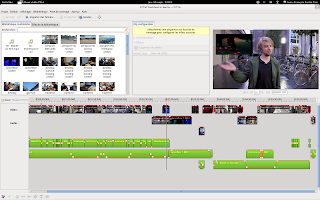

The PiTiVi team is proud to announce the [0.15 release](https://wiki.pitivi.org/wiki/0.15). This will be the last release using the "traditional" core/engine of PiTiVi. The next releases will be based on GStreamer Editing Services (GES) and should thus depart significantly from this release in terms of performance, features and stability.

  

  
  
  
  

Jean François did a great screencast that sums up what has been done during the last 2 years:

<iframe src="https://www.youtube-nocookie.com/embed/obLA4ZagGew" title="YouTube video" allowfullscreen loading="lazy"></iframe>

  
  

  
  
  

He also published the video of the 2011 desktop summit and PiTiVi/GES hackfest for your enjoyment

<iframe src="https://www.youtube-nocookie.com/embed/UlFrshNSqJ0" title="YouTube video" allowfullscreen loading="lazy"></iframe>

:  
  

  
  
  
All those videos are also accessible in HTML5 versions on the [showcase](http://pitivi.org/?go=showcase) page.  
  
  
  

Thanks to everybody who made this release possible!

  

