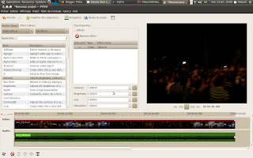

I didn't blog for almost 3 weeks but it doesn't mean I didn't progress with this project. I thing it actually means more that I prefer to spend my time on coding than on blogging!  
  
Last week was pretty full because of the end of the semester but tomorrow I have my last examen for university. Next week I am planning to go skiing so it may not be the week I will be hacking the most, but anyway, I will code!  
  
The UI is almost the same as [the mockup](http://lh6.ggpht.com/_3mLd5CtlHo4/TCIk1jYJH3I/AAAAAAAAHSw/J_ELnMPOmQE/s1152/Capture-3.png) I showed you last time apart from the key-frame thing since I am not sure I want to do it this way, and because I want to have effects stable before implementing this feature.  
  
So for now the UI looks exactly like:  
  
  
What is working:  

- Adding effects
- Configuring effects, the UI is generated automatically depending on the effect property so all effects are configurable. But there is also a system which will permit to create a special UI for more complicated effects.  
- Enabling/disabling effects even if a few bugs still remain concerning it  
- Removing effects

What doesn't work:  

- Seeking, right now when I add an effect and try to seek, it always go to the first frame of the video. It is a pretty critical bug on which I am actively working, and that's the reason why I didn't do a screen-cast (sorry about that). When this is solved, I will make a screen-cast and post it here for sure.  
- Drag'n drop directly to the effects list. This is almost nothing but I want to fix the first issue before implementing it.
- Keyframe based effect configuration
- Saving/opening projects containing effects. I have already started this work but it is still not working. It should be done quite easily.  

So I don't miss so many things to complete the plan I had made for this Google Summer of Code, but the idea is to get something almost bug free and merge and release it (something I have been told should be possible quite soon... I hope :))  
  
I also wanted to talk about [a tool](http://bicyclerepair.sourceforge.net/) I use for refactoring python code called 'Bicycle repair man'. It permits to rename variable/classes very easily and this through all python files of the project, cut functions into several ones and make the proper calls, and probably much more but those are the two features I actually use and abuse. I use it inside vim and noticed a real gain of productivity and style.  
  
The code is still available in my GIT repository here: <http://github.com/thiblahute/Pitivi>  
  
Hoping I can show you a screencast of all that and tell you that I need tester soon.
