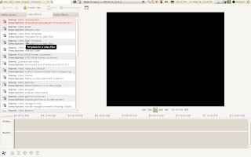

 

Here is the first report about [my Google summer of code project](http://thiblahute.blogspot.com/2010/04/i-have-been-accepetd-for-google-summer.html). I have been working quite a lot on it for the last 2 weeks! So here is the summary of what have been done so far:

- Code reading, analyze of Pitivi architecture (Thanks to the [pitivi wiki](http://wiki.pitivi.org/wiki/Main_Page))

- Some reading about Gstreamer to understand better the way it works

- Creation of [my git branch](http://github.com/thiblahute/pitivi) to start working on effects implementation

- Implementation of the core Pitivi modifications to be able to create effects (With unit tests)

- See how I can implement [effect files](http://live.gnome.org/AppIntegration/GstreamerVisualEffects) as described in my Gsoc application, and discussions about it in the Pitivi community. We actually didn't take a fixed decision about this for now.

- Creation of the UI to show the list of effects detected thanks to the [gstreamer registry](http://www.gstreamer.net/data/doc/gstreamer/head/gstreamer/html/GstRegistry.html) (the list was already retrieved in Pitivi)

- Some talking to know how this UI should be done. I will need to talk more about that to the Pitivi community to take a good decision about how it should look like. For now, it looks like:

I am now working on drag'n droping effects to the timeline.

That is all for now, and I will give you frequent news about how things are going.
