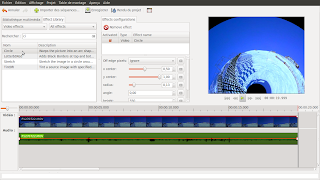

So as suggested by the title, the work I did during the Google Summer Of Code has been Merged! It means that the next Pitivi release which should arrive quite soon will gain effects.  
  
I haven't been blogging for a long while so sorry about not telling you what was happening but I did it in order to make a surprise :P  
  
Now that it is merged, you are very welcome to test it and report all the bugs you will find so we have a great release soon to propose the world.... with effects!  
  
Sorry for not making a screencast but as you can test it quite easily, it shouldn't matter so much ;) (and [nekohayo](http://jeff.ecchi.ca/blog/) is telling me he should make one soon)  
  
As I enjoyed a LOT working in the pitivi community during this summer, I am going to keep working on it in my free time fixing the bugs you are going to report. And of course I am planing to enhance effects support and add features such as keyframes handling...  
  
And just a little screenshot so you can have an idea about how the UI looks like now:  
  

