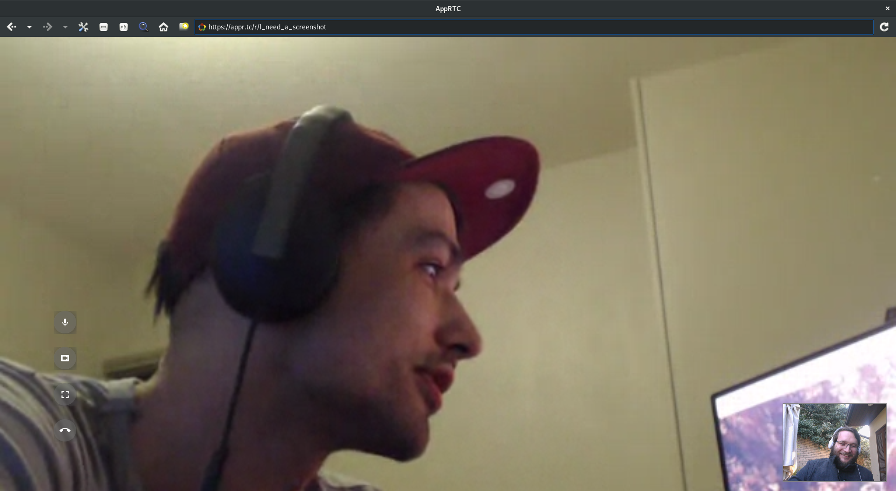
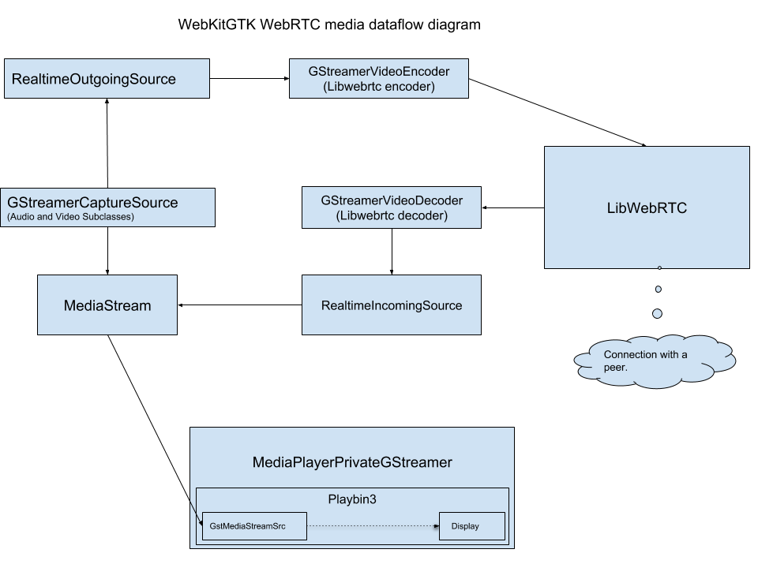

<a href="https://www.w3.org/TR/webrtc/" class="external">WebRTC</a> is a w3c draft protocol that “enables rich, high-quality RTP applications to be developed for the browser, mobile platforms, and IoT devices, and allow them all to communicate via a common set of protocols”. The protocol is mainly used to provide video conferencing systems from within web browsers.

<figure>

<figcaption aria-hidden="true">https://appr.tc running in WebKitGTK</figcaption>
</figure>

## A brief history

At the very beginning of the WebRTC protocol, before 2013, Google was still using WebKit in chrome and they started to implement support using <a href="https://webrtc.org/" class="external">LibWebRTC</a> but when they <a href="https://blog.chromium.org/2013/04/blink-rendering-engine-for-chromium.html" class="external">started the blink fork</a> the implementation stopped in WebKit.

Around 2015/2016 <a href="https://www.ericsson.com/research-blog/" class="external">Ericsson</a> and <a href="https://www.igalia.com/" class="external">Igalia</a> (later sponsored by <a href="https://www.metrological.com/" class="external">Metrological</a>) implemented <a href="https://blogs.igalia.com/xrcalvar/2016/10/03/webrtc-in-webkitwpe/" class="external">WebRTC support into WebKit</a>, but instead of using <a href="https://webrtc.org/" class="external">LibWebRTC</a> from google, <a href="https://www.openwebrtc.org/" class="external">OpenWebRTC</a> was used. This had the advantage of being implemented on top of the <a href="https://gstreamer.freedesktop.org/" class="external">GStreamer framework</a> which happens to be used for the Multimedia processing inside WebKitGTK and WebKitWPE. At that point in time, the standardization of the WebRTC protocol was still moving fast, mostly pushed by Google itself, and it was hard to be interoperable with the rest of the world. Despite of that, the WebKit/GTK/WPE WebRTC implementation started to be usable with website like <a href="https://appr.tc" class="external">appr.tc</a> at the end of 2016.

Meanwhile, in late 2016, Apple decided to implement WebRTC support on top of google LibWebRTC in their ports of WebKit which led to <a href="https://webkit.org/blog/7726/announcing-webrtc-and-media-capture/" class="external">WebRTC support in WebKit announcement</a> in June 2017.

Later in 2017 the OpenWebRTC project lost momentum and as it was considered unmaintained, we, at <a href="https://www.igalia.com/" class="external">Igalia</a>, decided to use LibWebRTC for WebKitGTK and WebKitWPE too. At that point, the OpenWebRTC backend was <a href="https://bugs.webkit.org/show_bug.cgi?id=177868" class="external">completely removed</a>.

## GStreamer/LibWebRTC implementation

Given that Apple had implemented a LibWebRTC based backend in WebKit, and because this library is being used by the two main web browsers (Chrome and Firefox), we decided to reuse Apple’s work to implement support in our ports based on LibWebRTC at the end of 2017. A that point, the two main APIs required to allow video conferencing with WebRTC needed to be implemented:

- <a href="https://developer.mozilla.org/en-US/docs/Web/API/MediaDevices/getUserMedia" class="external">MediaDevices.GetUserMedia</a> and <a href="https://developer.mozilla.org/en-US/docs/Web/API/MediaStream" class="external">MediaStream</a>: Allows to retrieve Audio and Video streams from the user Cameras and Microphones (potentially more than that but those are the main use cases we cared about).
- <a href="https://developer.mozilla.org/en-US/docs/Web/API/RTCPeerConnection" class="external">RTCPeerConnection</a>: Represents a WebRTC connection between the local computer and a remote peer.

As WeKit/GTK/WPE heavily relies on GStreamer for the multimedia processing, and given its flexibility, we made sure that our implementation of those APIs leverage the power of the framework and the existing integration of GStreamer in our WebKit ports.

Note that the whole implementation is reusing (after refactoring) big parts of the infrastructure introduced during the previously described history of WebRTC support in WebKit.

### GetUserMedia/MediaStream

To implement that part of the API the following main components were developed:

- RealtimeMediaSourceCenterLibWebRTC: Main entry point for our GStreamer based LibWebRTC backend.
- GStreamerCaptureDeviceManager: A class to list and manage local Video/Audio devices using the <a href="https://gstreamer.freedesktop.org/data/doc/gstreamer/head/gstreamer/html/gstreamer-GstDeviceMonitor.html" class="external">GstDeviceMonitor</a> API.
- GStreamerCaptureDevice: Implementation of WebKit abstraction for capture devices, basically wrapping GstDevices.
- GStreamerMediaStreamSource: A <a href="https://gstreamer.freedesktop.org/documentation/application-development/basics/elements.html#source-elements" class="external">GStreamer Source element</a> which wraps WebKit abstraction of MediaStreams to be used directly in a <a href="https://gstreamer.freedesktop.org/data/doc/gstreamer/head/gst-plugins-base-plugins/html/gst-plugins-base-plugins-playbin3.html" class="external">playbin3</a> pipeline (through a custom `mediastream://` protocol). This implementation leverages latest <a href="https://gstreamer.freedesktop.org/data/doc/gstreamer/head/gstreamer/html/gstreamer-GstStream.html" class="external">GstStream</a> APIs so it is already one foot into the future.

The main commit can be found <a href="https://trac.webkit.org/changeset/232589" class="external">here</a>

### RTCPeerConnection

Enabling the PeerConnection API meant bridging previously implemented APIs and the LibWebRTC backend developed by Apple:

- RealtimeOutgoing/Video/Audio/SourceLibWebRTC: Passing local stream (basically from microphone or camera) to LibWebRTC to be sent to the peer.
- RealtimeIncoming/Video/Audio/SourceLibWebRTC: Passing remote stream (from a remote peer) to the MediaStream object and in turn to the GStreamerMediaStreamSource element.

On top of that and to leverage GStreamer Memory management and negotiation capabilities we implemented encoders and decoder for LibWebRTC (namely GStreamerVideoEncoder and GStreamerVideoDecoders). This brings us a huge number of Hardware accelerated encoders and decoders implementations, especially on embedded devices, which is a big advantage in particular for WPE which is tuned for those platforms.

The main commit can be found <a href="https://trac.webkit.org/changeset/234138" class="external">here</a>

## Conclusion

While we were able to make GStreamer and LibWebRTC work well together in that implementation, using the new <a href="http://blog.nirbheek.in/2018/02/gstreamer-webrtc.html" class="external">GstWebRTC</a> component (that is now in upstream GStreamer) as a WebRTC backend would be cleaner. Many pieces of the current implementation could be reused and it would allow us to have a simpler infrastructure and avoid having several RTP stack in the WebKitGTK and WebKitWPE ports.

Most of the required APIs and features have been implemented, but a few are still under development (namely <a href="https://developer.mozilla.org/en-US/docs/Web/API/MediaDevices/enumerateDevices" class="external">MediaDevices.enumerateDevices</a>, <a href="https://bugs.webkit.org/show_bug.cgi?id=169811" class="external">canvas captureStream</a> and <a href="https://bugs.webkit.org/show_bug.cgi?id=186933" class="external">WebAudio and MediaStream bridging</a>) meaning that many Web applications using WebRTC already work, but some don’t yet, we are working on those!

A big thanks to my employer <a href="https://www.igalia.com/" class="external">Igalia</a> and <a href="https://www.metrological.com/" class="external">Metrological</a> for sponsoring our work on that!
